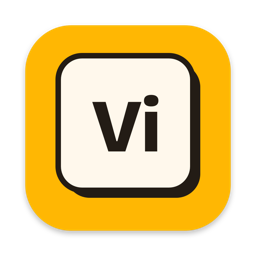
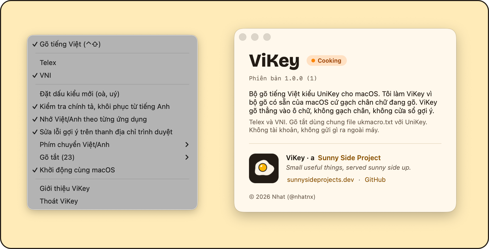

<p align="center">
  
</p>

# ViKey — bộ gõ tiếng Việt kiểu UniKey cho macOS

Gõ giống UniKey trên Windows: **không gạch chân**, không "kẹt" chữ trên Chrome/Electron. ViKey bắt phím toàn hệ thống (CGEventTap). Khi một từ cần đổi dạng (`tieen` → `tiên`), nó nuốt phím vừa gõ, gửi backspace và gõ lại phần chữ khác biệt. Nếu chỉ là gõ thường, phím được cho đi thẳng tới app.

<p align="center">
  
</p>

## Cài đặt

### Tải bản build sẵn

**[⬇ Tải ViKey bản mới nhất](https://github.com/sunnysideprojects/vikey/releases/latest)** (file `ViKey-x.y.z.zip`, macOS 13+, Apple Silicon và Intel)

1. Giải nén, kéo `ViKey.app` vào **Applications**.
2. App được ký bằng chứng chỉ riêng của ViKey nhưng chưa notarize nên macOS chặn lần đầu mở. Chuột phải vào app → **Open**, hoặc chạy:
   ```bash
   xattr -dr com.apple.quarantine /Applications/ViKey.app
   ```

### Hoặc tự build từ source

```bash
xcode-select --install        # nếu chưa có Command Line Tools
./build.sh --install          # self-test → build universal → cài vào /Applications → mở app
```

### Sau khi cài

Lần đầu mở, macOS sẽ hỏi quyền **Accessibility** → bật ViKey trong System Settings → Privacy & Security → Accessibility. App tự chạy ngay khi có quyền, không cần mở lại. Các bản cập nhật sau giữ nguyên quyền này; riêng khi nâng cấp từ bản 1.0.9 trở về trước (ký ad-hoc) thì cần xoá ViKey khỏi danh sách rồi bật lại một lần.

Sau đó:
- Gỡ bộ gõ "Vietnamese" của macOS trong System Settings → Keyboard → Input Sources, chỉ giữ **ABC**.
- Biểu tượng trên menu bar: **V** đỏ = tiếng Việt, **E** = tiếng Anh.

> Tự build thì app được ký ad-hoc, chữ ký đổi sau mỗi lần build nên quyền Accessibility cũ không còn khớp; `--install` tự reset quyền, bạn chỉ cần bật lại. Muốn giữ quyền qua các lần build, tạo một chứng chỉ ký riêng một lần bằng `bash scripts/make-signing-cert.sh`.

## Tính năng

| | |
|---|---|
| Kiểu gõ | Telex, VNI |
| Chuyển Việt/Anh | ⌃⇧ (mặc định), đổi được sang ⌘⇧ / ⌥⇧ / ⌃⌥ — bấm rồi nhả, không kèm phím khác |
| Đặt dấu tự do | `tiengse` → tiếng, `vieetj` → việt, dấu tự nhảy đúng vị trí khi gõ thêm |
| Kiểu đặt dấu | cũ `hòa, thủy` (mặc định) hoặc mới `hoà, thuỷ` |
| Khôi phục từ tiếng Anh | `windows`, `google`, `class`, `tesst` → `test`... không bị biến dấu |
| Gõ lại để huỷ dấu | `ass` → as, `aaa` → aa, `ddd` → dd, `ww` → w |
| Xoá lùi để sửa từ vừa gõ | gõ `tieeng` rồi dấu cách, xoá lùi một lần rồi gõ `s` → tiếng (VNI: `1`). Tắt được trong **Cài đặt → Gõ phím** |
| Phím tắt `w` | `w` → ư, `uow`/`uwow` → ươ, `thuowr` → thuở |
| Nhớ trạng thái theo app | ví dụ Terminal luôn E, Slack luôn V |
| Sửa lỗi trình duyệt | thanh địa chỉ Chrome/Edge/Safari/Firefox/Arc/Dia/Brave/Zen/Opera/Vivaldi/Orion/DuckDuckGo/Comet/Cốc Cốc (cả bản beta/dev) không nuốt chữ vì autocomplete |
| Báo Secure Input | khi ô mật khẩu hoặc Secure Keyboard Entry (Terminal, iTerm) chặn bộ gõ, biểu tượng hiện 🔒 và menu ghi app nào đang bật |
| Gõ tắt | dùng chung file `ukmacro.txt` với UniKey (để trên Google Drive được), tự nạp lại khi file đổi |
| Khởi động cùng macOS | qua `SMAppService` |
| Cài đặt | menu **Cài đặt…** (⌘,): các tab Gõ phím, Gõ tắt, Tương thích, Chung. Menu chỉ còn bật/tắt, Telex/VNI và công cụ clipboard |
| Kiểm tra cập nhật | menu **Kiểm tra cập nhật…**, và tự hỏi GitHub mỗi ngày một lần (tắt được trong **Cài đặt → Chung**). Chỉ đọc số phiên bản mới nhất, không gửi dữ liệu gì, không tự tải hay cài |

### Telex
`s` sắc · `f` huyền · `r` hỏi · `x` ngã · `j` nặng · `z` xoá dấu · `aa` â · `ee` ê · `oo` ô · `aw` ă · `ow` ơ · `uw`/`w` ư · `dd` đ

### VNI
`1` sắc · `2` huyền · `3` hỏi · `4` ngã · `5` nặng · `0` xoá dấu · `6` â ê ô · `7` ơ ư · `8` ă · `9` đ

## Cấu trúc

```
Sources/ViKeyCore/      engine thuần Swift, không phụ thuộc AppKit
  Vietnamese.swift      bảng nguyên âm/phụ âm, kiểm tra âm tiết hợp lệ, vị trí dấu, render
  Engine.swift          xử lý phím theo từ: dấu, mũ/móc, huỷ dấu, khôi phục, backspace
  RecentText.swift      nhớ các từ vừa gõ để xoá lùi vào sửa tiếp
  Macro.swift           đọc bảng gõ tắt định dạng UniKey
  Version.swift         so sánh số phiên bản (kiểm tra cập nhật)
Sources/ViKey/          app menu bar
  KeyTap.swift          CGEventTap: bắt phím, diff output, gửi backspace + Unicode
  AppDelegate.swift     menu, quyền Accessibility, nhớ trạng thái theo app
  Settings.swift        UserDefaults
  MacroFile.swift       theo dõi file ukmacro.txt (gõ tắt)
  SecureInput.swift     phát hiện Secure Input để báo trên menu bar
  UpdateChecker.swift   hỏi GitHub bản phát hành mới nhất
  SettingsWindow.swift  cửa sổ Cài đặt
  AboutWindow.swift     cửa sổ Giới thiệu
Sources/ViKeySelfTest/  test engine (build.sh chạy trước khi build)
Resources/              Info.plist, AppIcon.icns, logo + font brand
scripts/                vẽ lại icon app (build-icon.sh), đóng khung ảnh chụp màn hình (frame-screenshots.swift),
                        tạo chứng chỉ ký (make-signing-cert.sh), phát hành (release.sh),
                        test gõ phím thật qua ViKey (typing-test.sh + typing-cases.tsv)
docs/                   logo và ảnh chụp màn hình dùng trong README
reference/              bản engine Python tương đương + cases.tsv dùng chung
```

Thêm test: bổ sung dòng vào `reference/cases.tsv`, chạy `python3 reference/test_engine.py`, rồi `swift run -c release ViKeySelfTest` (test Swift đọc cùng file này).

## Giới hạn

- Ô mật khẩu (Secure Input) macOS chặn mọi event tap, nên ViKey không hoạt động ở đó, giống mọi bộ gõ dạng này. Khi đó biểu tượng trên menu bar hiện ổ khoá và chữ V chuyển xám.
- Bấm backspace khi đang ở giữa từ cũ (sau khi click chuột hoặc di chuyển con trỏ) sẽ không khôi phục được từ đó để sửa dấu. UniKey cũng vậy.
- Chỉ xuất Unicode dựng sẵn; không có TCVN3/VNI-Windows.

## Giấy phép

Code theo [MIT](LICENSE). Font Bricolage Grotesque theo SIL OFL 1.1; tên và logo Sunny Side Projects giữ bản quyền (xem cuối [LICENSE](LICENSE)).

---

 ViKey · a [Sunny Side Project](https://github.com/sunnysideprojects)
